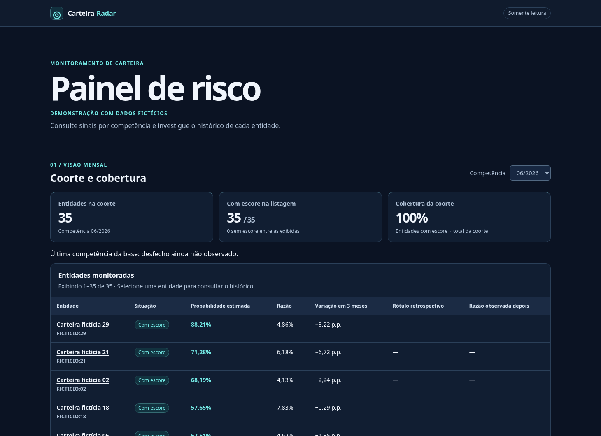

# Carteira Radar

**Quais carteiras de recebíveis merecem revisão primeiro?** O Carteira Radar estima a probabilidade de o indicador de atraso de um fundo ou classe subir pelo menos **2 pontos percentuais em três meses**, a partir dos informes mensais de FIDCs da CVM. O painel separa estimativa, resultado observado e ausência de avaliação. Não executa ordens, não recomenda investimentos e não aprova crédito.



## Resultado com dados reais

Em seis competências de teste, **XGBoost obteve AP 0,411 contra 0,303 da regra de tendência**. A precisão média mensal no top 10% foi **49,1% contra 46,6%**. O teste comparou os métodos nas mesmas 8.578 linhas com histórico e desfecho completos. Veja os [resultados, denominadores e limitações](docs/resultados.md). A imagem acima usa dados fictícios; os números desta seção vêm dos informes da CVM.

## Experimente

Pré-requisitos: [uv](https://docs.astral.sh/uv/) e Docker com Compose. Não há chaves de API, login de terceiros ou arquivo `.env` obrigatório.

```sh
uv sync --locked
uv run --locked python -m carteira_radar build --track
docker compose up -d --build --wait
```

Abra **http://127.0.0.1:8084**. Selecione uma competência do teste histórico para comparar previsão e resultado observado. Abra uma carteira para ver seu histórico e as contribuições de cada variável. A competência mais recente **dentro da base usada no experimento** não mostra um desfecho futuro. Para rodar sem baixar os informes, use `uv run --locked python -m carteira_radar build --fixture` no lugar do comando com `--track`; o painel identifica o conjunto como fictício.

O relatório completo é gerado em `artifacts/runs/`, junto com os hashes das entradas, as previsões e as variáveis em Parquet. O ponteiro `artifacts/CURRENT` só muda depois de validar o snapshot inteiro. A API documentada em `/docs` é de leitura, não treina modelos durante a requisição.

## Método

```text
Informes CVM (ZIP) → validação e lags por competência → Parquet / DuckDB
        → treino temporal e comparação com baseline → snapshot + MLflow local
        → FastAPI somente leitura → Angular
```

O baseline ranqueia pela piora já observada no trimestre anterior. A regressão logística e o XGBoost são comparados na validação, sem usar os rótulos do teste para escolher a família. A partição de teste fica intacta; há um intervalo entre partições para que os desfechos tenham maturado. A explicação local usa contribuições aditivas em log-odds, não atribuição causal.

**Importante:** os informes históricos podem conter reapresentações. O experimento é retrospectivo com dados revisados, não uma reprodução do que estava publicado em cada dia do passado. A razão de atraso é uma métrica experimental, não uma classificação regulatória. Não há alegação de calibração prospectiva nem de desempenho em produção.

- [Dados: fórmula, cobertura e linhagem](docs/dados.md)
- [Modelo: cortes temporais, baseline e métricas](docs/modelo.md)
- [Operação e diagnóstico](docs/operacao.md)

A fonte é a [CVM — Informes Mensais de FIDC](https://dados.cvm.gov.br/dataset/fidc-doc-inf_mensal). Os ZIPs e os resultados identificáveis não são versionados. Consulte a licença dos dados no catálogo da CVM. Nenhuma credencial do usuário é usada para baixar os arquivos.
